# HomesAbove

HomesAbove turns a walk down a main street into a ranked list of upper floors worth a council inspection. A volunteer photographs shopfronts from the opposite pavement. Two AI models from different families read each facade independently, OpenStreetMap supplies the services within walking distance, and a council officer gets a ranked list of candidates, a 3D map of the street, and an agent that answers questions through read-only tools. When an inspection confirms a candidate, the walker who took the photo earns a badge.

It was built in one day at Build for Ireland (OpenAI × Give(a)Go × Dogpatch Labs, Dublin, 4 October 2026). The product treats a photo as a reason to look, never as a verdict. It says "likely underused" and "candidate for inspection", sends every disagreement between the two models to a person, leaves grant eligibility to the council, and never shows a walker what the AI thought of a building.

[](#credits)
[](backend/requirements.txt)
[](backend/app/main.py)
[](web/package.json)
[](backend/scripts/init_db.py)
[](backend/mcp_server.py)

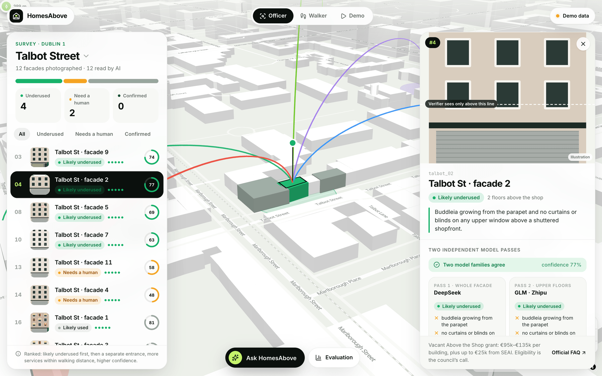

[What the code enforces](#what-the-code-enforces) · [Product tour](#product-tour) · [How it works](#how-it-works) · [Run it in a minute](#run-locally) · [Team contract](contracts/CONTRACT.md) · [Vision prompts](pipeline/prompts/)

> [!IMPORTANT]
> Every screenshot on this page uses the app's bundled demo dataset: real OpenStreetMap footprints and streets in central Dublin, with invented walks, readings, statuses, register flags and shop-staff answers. None of it describes the real buildings. Buildings are named by capture order ("Talbot St · facade 2"), never by house number, and the facade images are drawings that the app marks "Illustration".

## What the code enforces

Each row is a rule from the [team contract](contracts/CONTRACT.md), the code that enforces it, and what checks it. Where nothing automated checks a rule yet, the last column says so.

| Rule | How the code enforces it | Checked by |
| --- | --- | --- |
| A facade is "likely underused" only if the model names a visible signal | The survey prompt asks for one, and [`clean_reading`](backend/app/domain.py#L42) downgrades an answer with no signals to `unclear` | No automated check yet |
| The two readings come from different model families | [`verify.py`](pipeline/verify.py#L77) refuses to start when `VISION_MODEL` and `VERIFIER_MODEL` share a family; [the provider probe](pipeline/probe_providers.py#L250) picks the verifier from another family | No automated check yet |
| The verifier cannot copy the first reading | It sees only the top 55% of the photo ([`imaging.py:13`](backend/app/imaging.py#L13)), answers a different question ([`verify.txt`](pipeline/prompts/verify.txt)) and is never shown pass 1's answer | No automated check yet |
| Disagreement or low confidence goes to a person | [`review_fields`](backend/app/domain.py#L48) sets `needs_human` when the passes disagree or confidence is below 0.6; the building shows as "Needs a human" until someone screens it | No automated check yet |
| A model that fails twice produces no judgement | Strict JSON schema, Pydantic validation and one retry with the error appended ([`llm.py:138`](backend/app/llm.py#L138)); after that the building is `unclear` and sent to a person ([`survey_vision.py:83`](pipeline/survey_vision.py#L83), [`verify.py:62`](pipeline/verify.py#L62)) | No automated check yet |
| Model text never says "vacant" | [`_scrub`](backend/app/domain.py#L28) rewrites the word in every signal and evidence sentence; the agent sees the ground-floor value as "appears unused" ([`mcp_server.py:88`](backend/mcp_server.py#L88)) | [`record_demo.py`](backend/scripts/record_demo.py#L23) flags "vacant", "empty" and "eligib…" in recorded answers; [a unit test](backend/app/gamification/tests/test_engine.py#L243) keeps the word out of the badge catalog |
| A walker never sees an AI status | Walker routes read buildings through an explicit field projection ([`routes.py:22`](backend/app/gamification/routes.py#L22)) | [`test_walks_privacy`](backend/app/gamification/tests/test_engine.py#L260); the [smoke test](backend/scripts/smoke.py#L185) checks the live API too |
| Badges reward walking, never AI judgements | The engine reads capture fields, the street, the floor count and shop-staff answers, never a status ([`engine.py:61`](backend/app/gamification/engine.py#L61)); Homes Above and Lights On come only from an inspection an officer recorded | [`test_inspection_badges_not_from_evaluate`](backend/app/gamification/tests/test_engine.py#L139) |
| Each badge is awarded once | The award `_id` is `walker:badge:building`, backed by a unique index ([`engine.py:178`](backend/app/gamification/engine.py#L178)) | [`test_first_look_once`](backend/app/gamification/tests/test_engine.py#L74), [`test_duplicate_key_from_index_is_ignored`](backend/app/gamification/tests/test_engine.py#L212) |
| The agent can only read | The MCP server exposes eight tools, all reads over `repo.py` ([`mcp_server.py`](backend/mcp_server.py#L71)); labels and inspections exist only as REST routes behind a person's click | The [smoke test](backend/scripts/smoke.py#L276) asserts exactly those eight tool names |
| Every tool call reports what it did in the database | [`traced`](backend/mcp_server.py#L39) adds `{db_op, ms}` to each result; similar search reports `cosine-fallback` when Atlas vector search could not answer ([`repo.py:157`](backend/app/repo.py#L157)) | The [smoke test](backend/scripts/smoke.py#L265) requires `db_op` and `ms` on every `tool_result` |
| No eligibility claims about the grant | [`grant_info`](backend/mcp_server.py#L29) returns the amounts and the [official FAQ](https://www.sdcc.ie/en/services/housing/vacant-homes/vacant-above-the-shop-grant-faqs.pdf) link, with no eligibility rules; the [agent instructions](backend/app/agent.py#L52) forbid eligibility statements | [`record_demo.py`](backend/scripts/record_demo.py#L63) fails a grant answer that lacks the FAQ link |
| Served photos carry no location | Every served copy is re-encoded from pixels, so no EXIF or GPS survives ([`imaging.py:50`](backend/app/imaging.py#L50)); originals stay in the git-ignored `data/photos/` | No automated check yet |
| No model request goes to OpenAI | All inference goes to the TensorX base URL, and Agents SDK tracing is switched off ([`agent.py:24`](backend/app/agent.py#L24)) | No automated check yet |
| The screen says where its data comes from | When the API is unreachable the client switches to local data ([`api.ts:54`](web/src/lib/api.ts#L54)), and the top bar reads Live, Static export or Demo data ([`TopNav.tsx:17`](web/src/app/TopNav.tsx#L17)) | Visible in every screenshot below |

The badge engine and walker routes have 27 tests in [one file](backend/app/gamification/tests/test_engine.py). They run against mongomock, so they need no database. [`smoke.py`](backend/scripts/smoke.py) checks every contract endpoint (the writes behind flags), the event stream, the agent stream and the MCP tool list against a running stack. Run for this README on 12 October 2026: 27 of 27 tests passed in 0.05 s, and `tsc` type-checked the web app with no errors. The smoke test needs Atlas and a TensorX key, so it was not re-run.

## Product tour

The screenshots and animations were captured on 12 October 2026 from `npm run dev` with no backend running, so the app fell back to its demo dataset and says **Demo data** in the top bar. Desktop captures are 1440 × 900.

### The loop, end to end

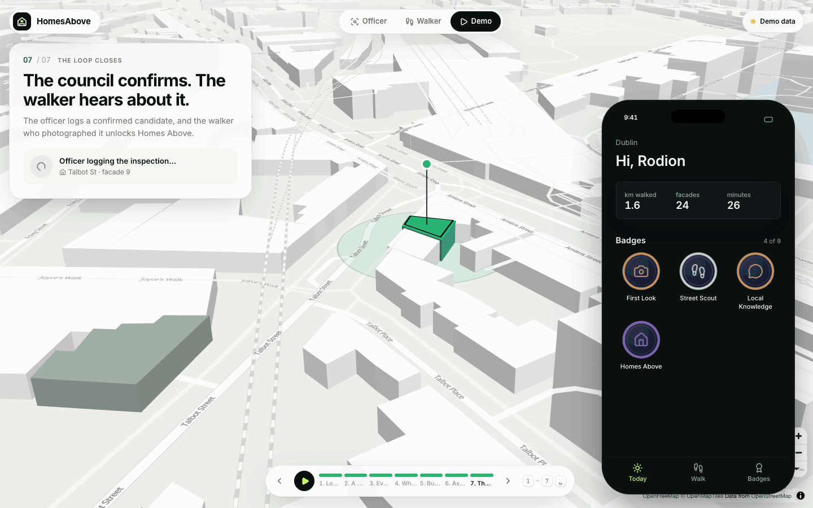

The officer records Talbot St · facade 9 as a confirmed candidate. The building turns dark green on the map, and the phone of the walker who photographed it shows Homes Above. With the API running, that moment is a `badge.awarded` event on `GET /api/events`. In demo mode the same three events travel over the app's local event bus ([`api.ts:215`](web/src/lib/api.ts#L215)), so the phone reacts exactly as it would to the server.

### One building, two readings

<table>
  <tr>
    <th width="50%">Both passes agree</th>
    <th width="50%">The passes disagree</th>
  </tr>
  <tr>
    <td valign="top">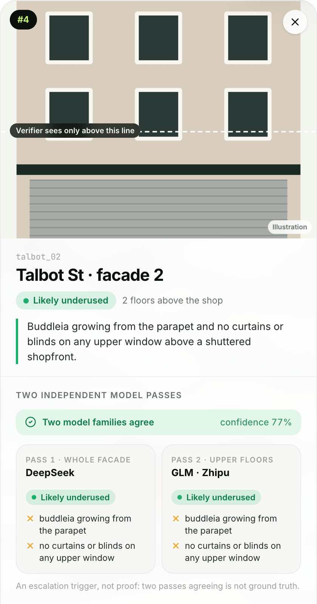</td>
    <td valign="top">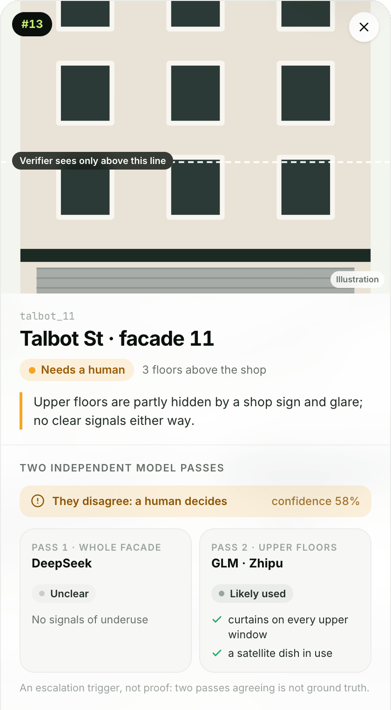</td>
  </tr>
  <tr>
    <th>Services within walking distance</th>
    <th>The decision stays with a person</th>
  </tr>
  <tr>
    <td valign="top">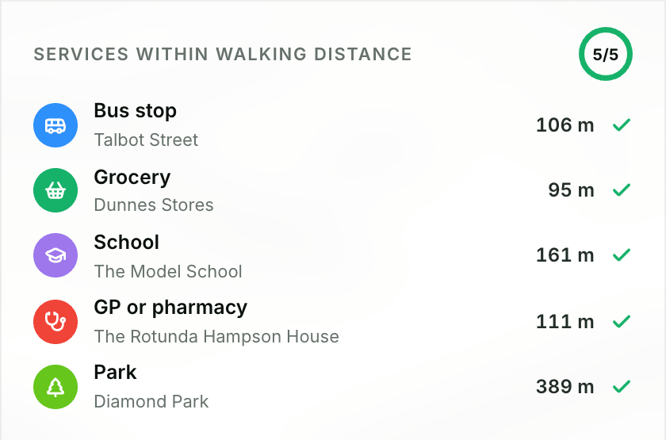</td>
    <td valign="top">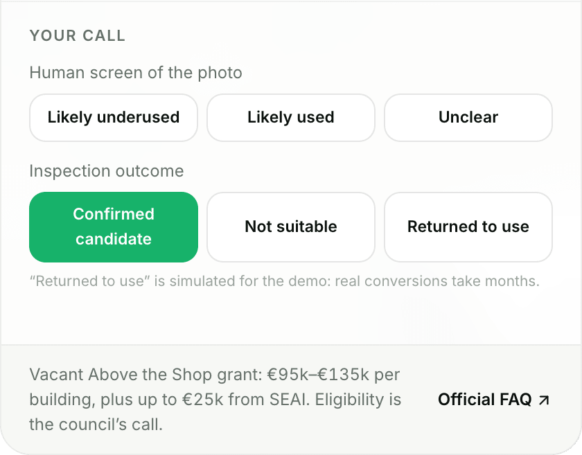</td>
  </tr>
</table>

Pass 1 reads the whole facade. Pass 2 comes from another model family, sees only what lies above the dashed line, and lists signs for and against use. On the left both read facade 2 as likely underused, so it ranks fourth of the 24 demo facades. On the right pass 1 could not tell and pass 2 saw curtains and a satellite dish, so facade 11 waits in the review queue until an officer screens the photo. The panel also shows the public-register check and look-alike facades. The footer gives the grant amounts, says that eligibility is the council's call, and links the official FAQ.

### Ask HomesAbove

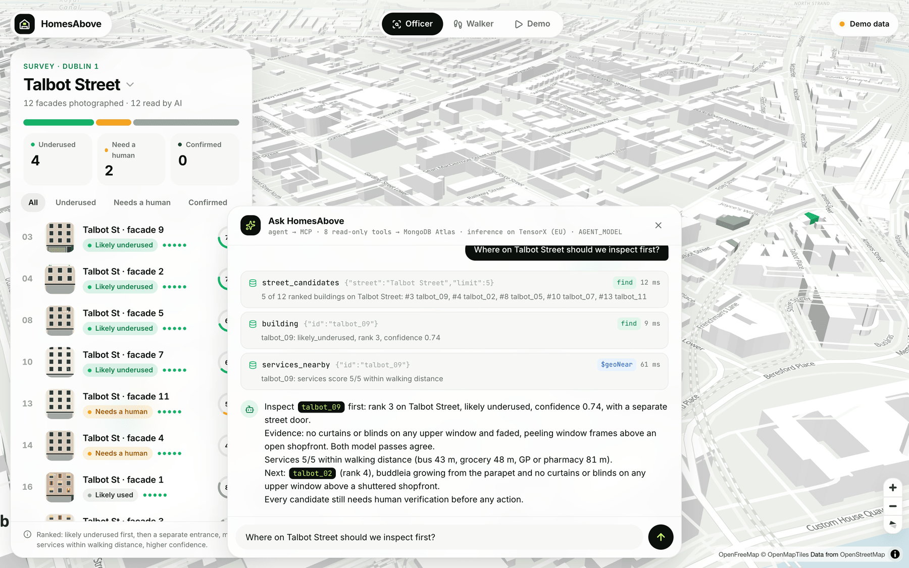

The officer asks where to inspect first. The agent calls `street_candidates`, then `building` and `services_nearby` for the top candidate, and each call reports its MongoDB operation and time. Building ids in the answer are buttons that fly the map to that building ([`AgentSheet.tsx:28`](web/src/views/officer/AgentSheet.tsx#L28)). In demo mode this is a bundled transcript replayed with its timings, so its numbers are illustrative. Live answers come from `AGENT_MODEL` through the MCP server, and `DEMO_CACHE=1` replays recorded live runs.

### The walker

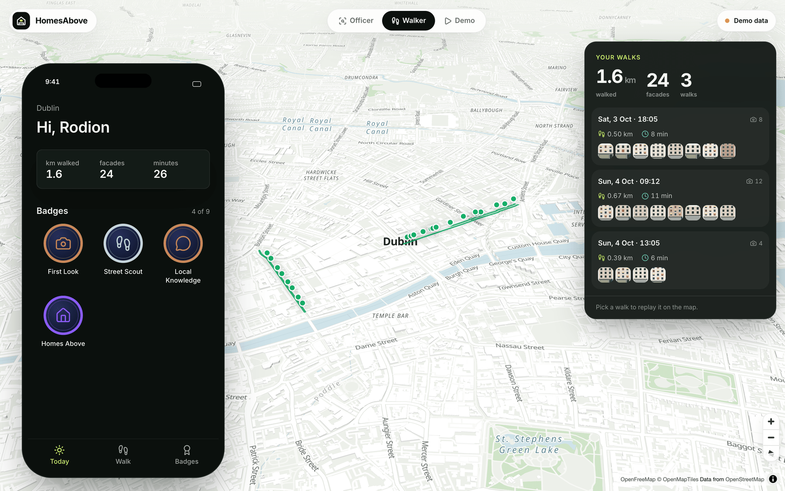

The walker sees their own walks, photo points and totals, and their app in the phone frame. No AI status appears anywhere in this view. That is a product rule, and the API enforces it with an explicit projection, so the fields never leave the server.

<table>
  <tr>
    <td align="center" width="25%">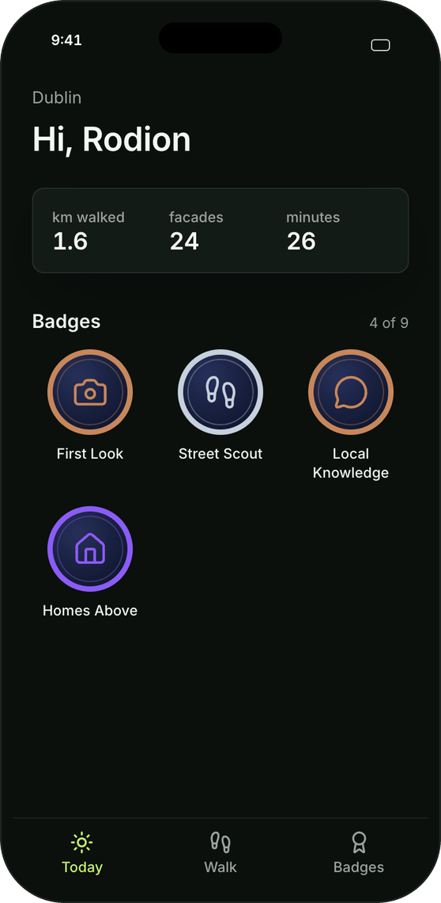</td>
    <td align="center" width="25%">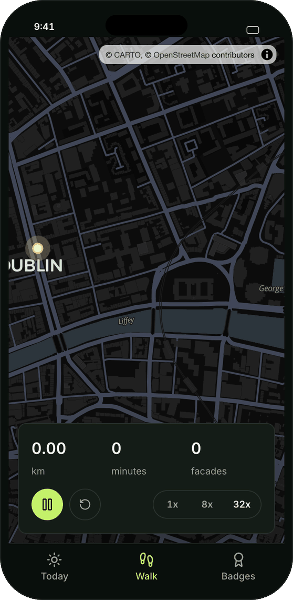</td>
    <td align="center" width="25%">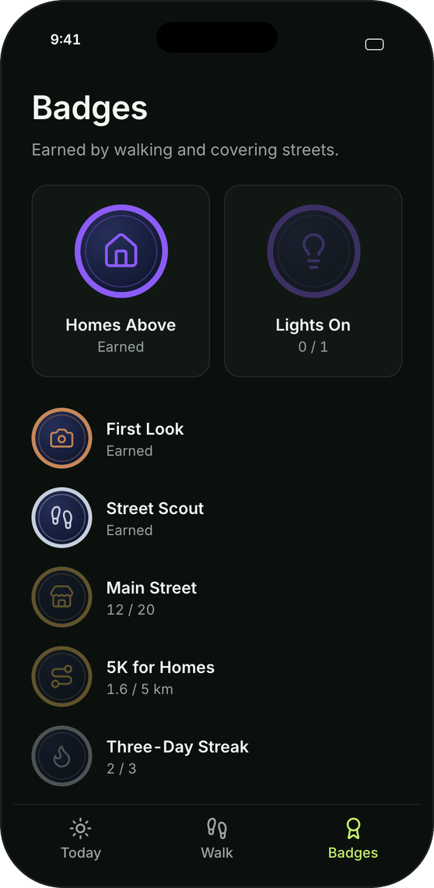</td>
    <td align="center" width="25%">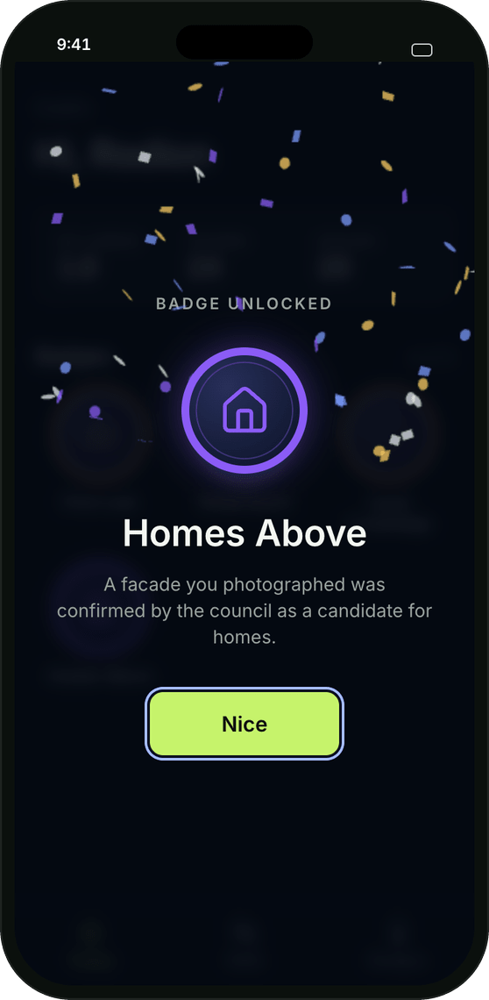</td>
  </tr>
  <tr>
    <td align="center">Today</td>
    <td align="center">Walk replay at 32×</td>
    <td align="center">Badges, civic first</td>
    <td align="center">Unlock</td>
  </tr>
</table>

Photo points on the walk replay are a neutral gold, never a status colour ([`WalkMap.tsx:16`](web/src/walker/WalkMap.tsx#L16)). The unlock screen appears when a `badge.awarded` event names this walker. The still capture above used the walker app's <kbd>B</kbd> test shortcut; the animation in [the loop](#the-loop-end-to-end) shows the real path.

#### Where the demo walks go

GitHub renders the block below as a map you can drag and zoom. It holds the three demo walks and their 24 photo points. The streets are real, and the walks and times are invented. Following the walker-view rule, it carries no AI statuses.

```geojson
{"type":"FeatureCollection","features":[
{"type":"Feature","properties":{"walk":"Capel Street walk","when":"Sat 3 Oct 2026, 18:05–18:13","distance":"501 m","facades photographed":8,"stroke":"#7C3AED","stroke-width":4,"stroke-opacity":0.9},"geometry":{"type":"LineString","coordinates":[[-6.26795,53.34654],[-6.26934,53.35022],[-6.26964,53.35058],[-6.26974,53.3509]]}},
{"type":"Feature","properties":{"photo":"1 of 8","walk":"Capel Street walk","taken":"18:05:24","marker-color":"#7C3AED","marker-size":"small","marker-symbol":"camera"},"geometry":{"type":"Point","coordinates":[-6.26803,53.34674]}},
{"type":"Feature","properties":{"photo":"2 of 8","walk":"Capel Street walk","taken":"18:06:13","marker-color":"#7C3AED","marker-size":"small","marker-symbol":"camera"},"geometry":{"type":"Point","coordinates":[-6.26818,53.34714]}},
{"type":"Feature","properties":{"photo":"3 of 8","walk":"Capel Street walk","taken":"18:07:19","marker-color":"#7C3AED","marker-size":"small","marker-symbol":"camera"},"geometry":{"type":"Point","coordinates":[-6.2684,53.34772]}},
{"type":"Feature","properties":{"photo":"4 of 8","walk":"Capel Street walk","taken":"18:08:09","marker-color":"#7C3AED","marker-size":"small","marker-symbol":"camera"},"geometry":{"type":"Point","coordinates":[-6.26856,53.34814]}},
{"type":"Feature","properties":{"photo":"5 of 8","walk":"Capel Street walk","taken":"18:09:14","marker-color":"#7C3AED","marker-size":"small","marker-symbol":"camera"},"geometry":{"type":"Point","coordinates":[-6.26878,53.34872]}},
{"type":"Feature","properties":{"photo":"6 of 8","walk":"Capel Street walk","taken":"18:10:06","marker-color":"#7C3AED","marker-size":"small","marker-symbol":"camera"},"geometry":{"type":"Point","coordinates":[-6.26894,53.34915]}},
{"type":"Feature","properties":{"photo":"7 of 8","walk":"Capel Street walk","taken":"18:11:19","marker-color":"#7C3AED","marker-size":"small","marker-symbol":"camera"},"geometry":{"type":"Point","coordinates":[-6.2692,53.34983]}},
{"type":"Feature","properties":{"photo":"8 of 8","walk":"Capel Street walk","taken":"18:12:10","marker-color":"#7C3AED","marker-size":"small","marker-symbol":"camera"},"geometry":{"type":"Point","coordinates":[-6.26935,53.35024]}},
{"type":"Feature","properties":{"walk":"North Earl and Talbot Street walk","when":"Sun 4 Oct 2026, 09:12–09:23","distance":"668 m","facades photographed":12,"stroke":"#17B26A","stroke-width":4,"stroke-opacity":0.9},"geometry":{"type":"LineString","coordinates":[[-6.2601,53.34976],[-6.25539,53.3505],[-6.25387,53.35077],[-6.25239,53.35097],[-6.25212,53.35105],[-6.25076,53.35127],[-6.25043,53.35135]]}},
{"type":"Feature","properties":{"photo":"1 of 12","walk":"North Earl and Talbot Street walk","taken":"09:12:20","marker-color":"#17B26A","marker-size":"small","marker-symbol":"camera"},"geometry":{"type":"Point","coordinates":[-6.25985,53.3498]}},
{"type":"Feature","properties":{"photo":"2 of 12","walk":"North Earl and Talbot Street walk","taken":"09:12:49","marker-color":"#17B26A","marker-size":"small","marker-symbol":"camera"},"geometry":{"type":"Point","coordinates":[-6.25956,53.34985]}},
{"type":"Feature","properties":{"photo":"3 of 12","walk":"North Earl and Talbot Street walk","taken":"09:13:14","marker-color":"#17B26A","marker-size":"small","marker-symbol":"camera"},"geometry":{"type":"Point","coordinates":[-6.25935,53.34988]}},
{"type":"Feature","properties":{"photo":"4 of 12","walk":"North Earl and Talbot Street walk","taken":"09:14:08","marker-color":"#17B26A","marker-size":"small","marker-symbol":"camera"},"geometry":{"type":"Point","coordinates":[-6.25859,53.35001]}},
{"type":"Feature","properties":{"photo":"5 of 12","walk":"North Earl and Talbot Street walk","taken":"09:14:57","marker-color":"#17B26A","marker-size":"small","marker-symbol":"camera"},"geometry":{"type":"Point","coordinates":[-6.25794,53.35011]}},
{"type":"Feature","properties":{"photo":"6 of 12","walk":"North Earl and Talbot Street walk","taken":"09:15:19","marker-color":"#17B26A","marker-size":"small","marker-symbol":"camera"},"geometry":{"type":"Point","coordinates":[-6.25779,53.35013]}},
{"type":"Feature","properties":{"photo":"7 of 12","walk":"North Earl and Talbot Street walk","taken":"09:15:45","marker-color":"#17B26A","marker-size":"small","marker-symbol":"camera"},"geometry":{"type":"Point","coordinates":[-6.25756,53.35017]}},
{"type":"Feature","properties":{"photo":"8 of 12","walk":"North Earl and Talbot Street walk","taken":"09:17:02","marker-color":"#17B26A","marker-size":"small","marker-symbol":"camera"},"geometry":{"type":"Point","coordinates":[-6.25637,53.35035]}},
{"type":"Feature","properties":{"photo":"9 of 12","walk":"North Earl and Talbot Street walk","taken":"09:19:14","marker-color":"#17B26A","marker-size":"small","marker-symbol":"camera"},"geometry":{"type":"Point","coordinates":[-6.25414,53.35073]}},
{"type":"Feature","properties":{"photo":"10 of 12","walk":"North Earl and Talbot Street walk","taken":"09:19:38","marker-color":"#17B26A","marker-size":"small","marker-symbol":"camera"},"geometry":{"type":"Point","coordinates":[-6.25395,53.35076]}},
{"type":"Feature","properties":{"photo":"11 of 12","walk":"North Earl and Talbot Street walk","taken":"09:20:02","marker-color":"#17B26A","marker-size":"small","marker-symbol":"camera"},"geometry":{"type":"Point","coordinates":[-6.25376,53.35079]}},
{"type":"Feature","properties":{"photo":"12 of 12","walk":"North Earl and Talbot Street walk","taken":"09:22:09","marker-color":"#17B26A","marker-size":"small","marker-symbol":"camera"},"geometry":{"type":"Point","coordinates":[-6.25164,53.35113]}},
{"type":"Feature","properties":{"walk":"Talbot Street lunch walk","when":"Sun 4 Oct 2026, 13:05–13:10","distance":"387 m","facades photographed":4,"stroke":"#2E90FA","stroke-width":4,"stroke-opacity":0.9},"geometry":{"type":"LineString","coordinates":[[-6.25062,53.35145],[-6.25084,53.35139],[-6.25215,53.35118],[-6.25242,53.3511],[-6.25391,53.35089],[-6.25621,53.35051]]}},
{"type":"Feature","properties":{"photo":"1 of 4","walk":"Talbot Street lunch walk","taken":"13:05:16","marker-color":"#2E90FA","marker-size":"small","marker-symbol":"camera"},"geometry":{"type":"Point","coordinates":[-6.25078,53.3514]}},
{"type":"Feature","properties":{"photo":"2 of 4","walk":"Talbot Street lunch walk","taken":"13:06:51","marker-color":"#2E90FA","marker-size":"small","marker-symbol":"camera"},"geometry":{"type":"Point","coordinates":[-6.25231,53.35113]}},
{"type":"Feature","properties":{"photo":"3 of 4","walk":"Talbot Street lunch walk","taken":"13:08:44","marker-color":"#2E90FA","marker-size":"small","marker-symbol":"camera"},"geometry":{"type":"Point","coordinates":[-6.25417,53.35085]}},
{"type":"Feature","properties":{"photo":"4 of 4","walk":"Talbot Street lunch walk","taken":"13:09:52","marker-color":"#2E90FA","marker-size":"small","marker-symbol":"camera"},"geometry":{"type":"Point","coordinates":[-6.25519,53.35067]}}
]}
```

### The guided demo

`/demo` tells the whole story in seven steps on the same map, with the walker's phone on the right. Press <kbd>1</kbd>–<kbd>7</kbd> to jump to a step, <kbd>←</kbd> and <kbd>→</kbd> to move, and <kbd>Space</kbd> to autoplay ([`DemoView.tsx:24`](web/src/views/demo/DemoView.tsx#L24)).

| # | Step | What the map does |
| ---: | --- | --- |
| 1 | Look above any shop | Orbits the street with no colours |
| 2 | A morning walk becomes evidence | Replays the walk at 26× and lights each facade as it is photographed |
| 3 | Every facade, read twice | Reveals each reading, best rank first, with live counts |
| 4 | When they disagree, a human decides | Flies to a building where the two passes disagree and shows both |
| 5 | Bus, grocery, GP: already there | Draws arcs to the nearest services and scores them out of five |
| 6 | Ask in plain English | Replays the agent's answer with its tool calls |
| 7 | The council confirms. The walker hears about it. | Records the inspection; the phone unlocks Homes Above |

<details>
<summary>All seven steps</summary>

<table>
  <tr>
    <td width="50%">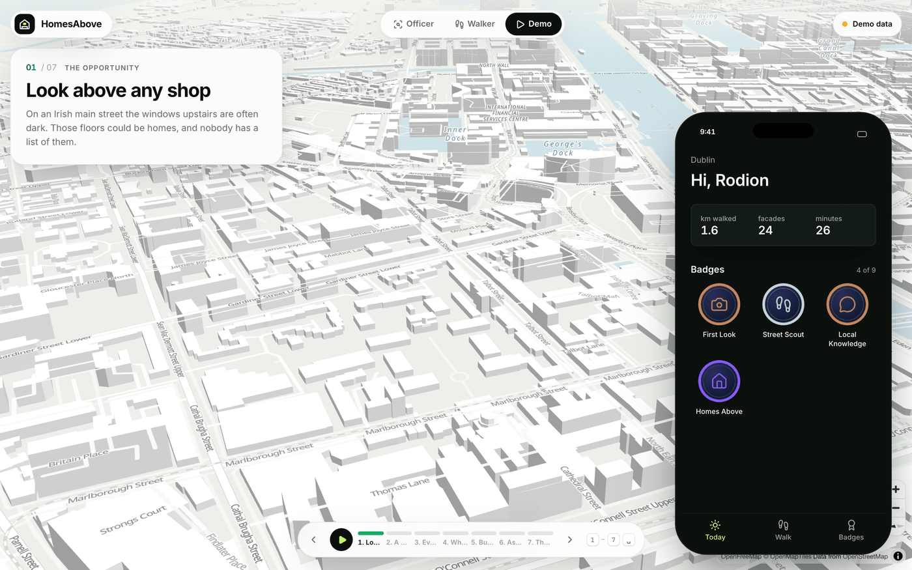</td>
    <td width="50%">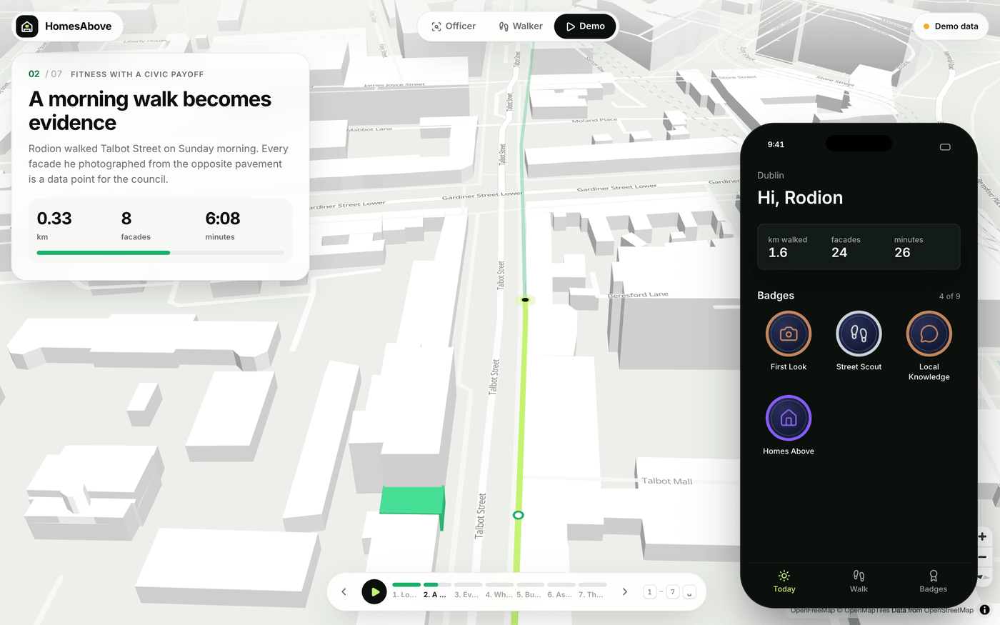</td>
  </tr>
  <tr>
    <td>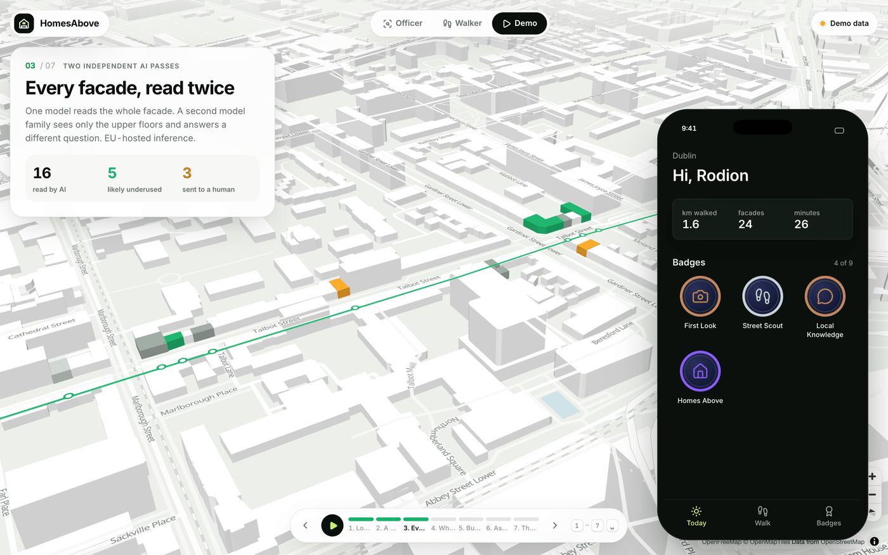</td>
    <td>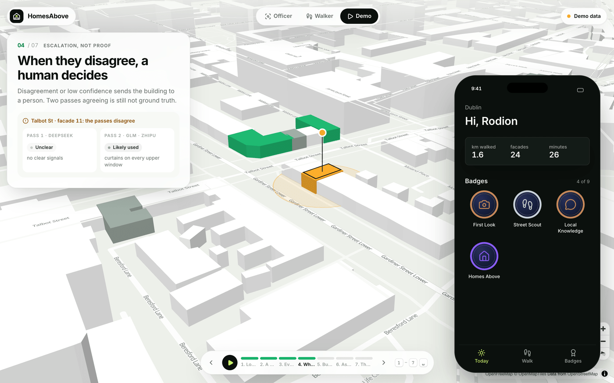</td>
  </tr>
  <tr>
    <td>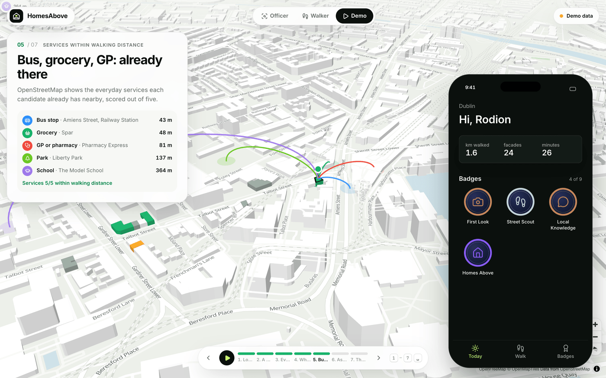</td>
    <td>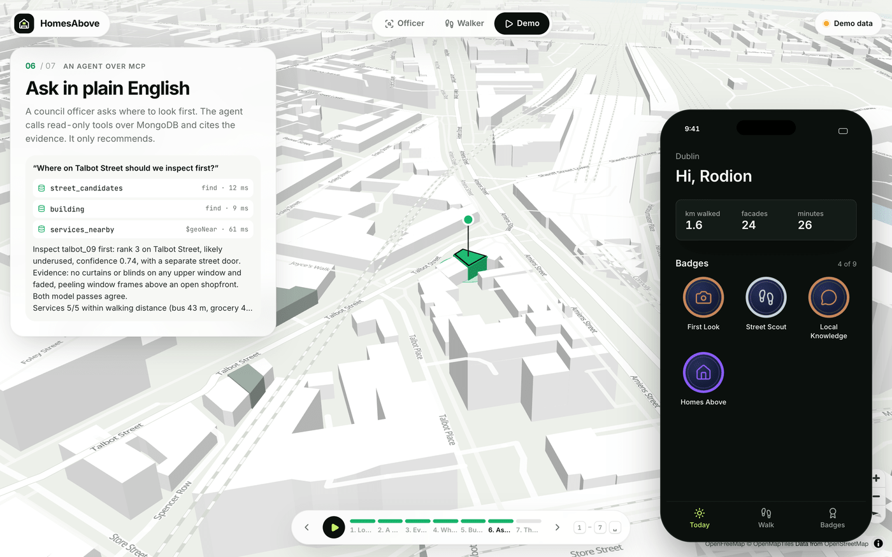</td>
  </tr>
  <tr>
    <td>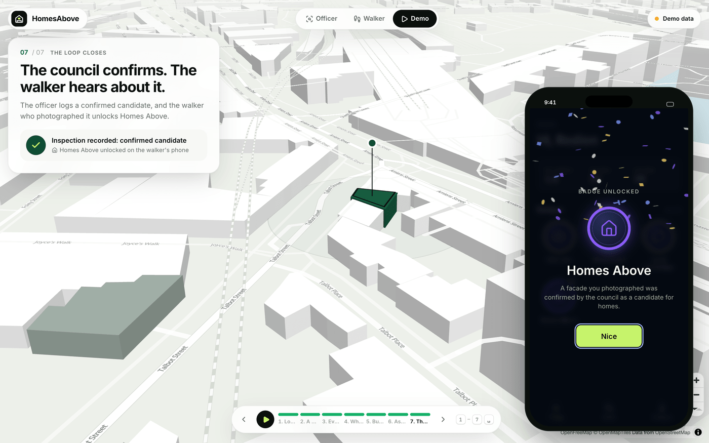</td>
    <td></td>
  </tr>
</table>

</details>

## How it works

The browser talks to one FastAPI process. The officer's agent runs inside it and reaches the database only through the MCP server, which wraps the same `repo.py` functions the REST routes use.

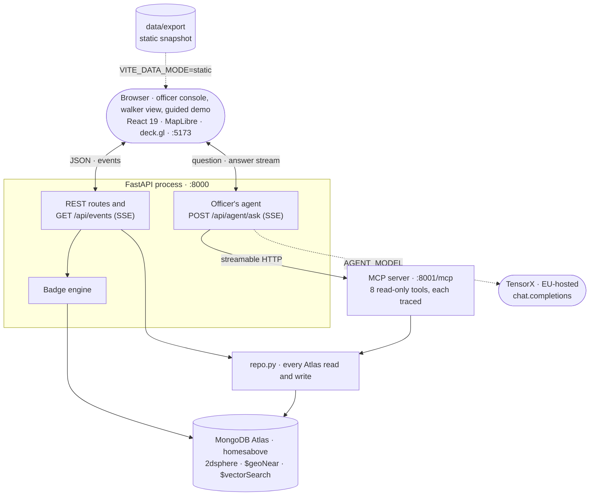

Photos become candidates in a batch pipeline. [`pipeline/real_photos.sh`](pipeline/real_photos.sh) runs steps 2 to 7 in one command. Every step is idempotent and `$set`s only its own fields, so any step can be re-run alone.

| # | Step | Writes | Calls out to |
| ---: | --- | --- | --- |
| 1 | [`walker/import_walk.py`](walker/import_walk.py) | walkers, walks, and the capture fields `captured_by`, `captured_at`, `walk_id`, `phash` | the API, to run the badge engine |
| 2 | [`survey_vision.py`](pipeline/survey_vision.py), pass 1 | the reading, location, label, and a 1024 px copy with no metadata in `data/photos_web/` | TensorX, `VISION_MODEL` |
| 3 | [`verify.py`](pipeline/verify.py), pass 2 | `verifier`, `needs_human` | TensorX, `VERIFIER_MODEL` |
| 4 | [`geo.py`](pipeline/geo.py) | footprint, location, height; `data/export/context.geojson` | Overpass, once, then the cache |
| 5 | [`services.py`](pipeline/services.py) | the `pois` collection, services, rank | Overpass, once, then the cache |
| 6 | [`eval.py`](pipeline/eval.py) | `data/export/eval.json` | TensorX, `AGENT_MODEL`, for shop-staff answers not yet cached |
| 7 | [`export.py`](pipeline/export.py), then `npm run sync-data` | `data/export/`, copied into `web/public/` | the API, for walker files |
| – | [`registers.py`](pipeline/registers.py), optional | `registers.derelict`, `registers.protected` | data.smartdublin.ie, once, then the cache |
| – | [`embed.py`](pipeline/embed.py), optional | `embedding`, and the vector index if it is missing | TensorX `EMBED_MODEL`, or a local fastembed model |

| Component | Owns | Talks to | Port |
| --- | --- | --- | --- |
| [web](web/) | officer console, walker view, guided demo; one shared 3D map | API, or the static or bundled data when the API is down | 5173 |
| [API](backend/app/main.py) | REST routes, the event stream, the agent stream | Atlas, badge engine, agent | 8000 |
| [MCP server](backend/mcp_server.py) | eight read-only tools, each traced with `{db_op, ms}` | Atlas through `repo.py` | 8001, path `/mcp` |
| [agent](backend/app/agent.py) | the officer's questions; up to 8 turns, 120 s, temperature 0 | MCP server, TensorX | in the API process |
| [badge engine](backend/app/gamification/engine.py) | stats, progress and awards | Atlas | in the API process |
| [pipeline](pipeline/) | both readings, footprints, services, ranks, registers, vectors, eval, export | TensorX, Overpass (cached), data.smartdublin.ie, Atlas | batch |
| [walker import](walker/import_walk.py) | walkers, walks, capture times, perceptual hashes | Atlas, then the API's badge engine | batch |

### Reading a facade twice

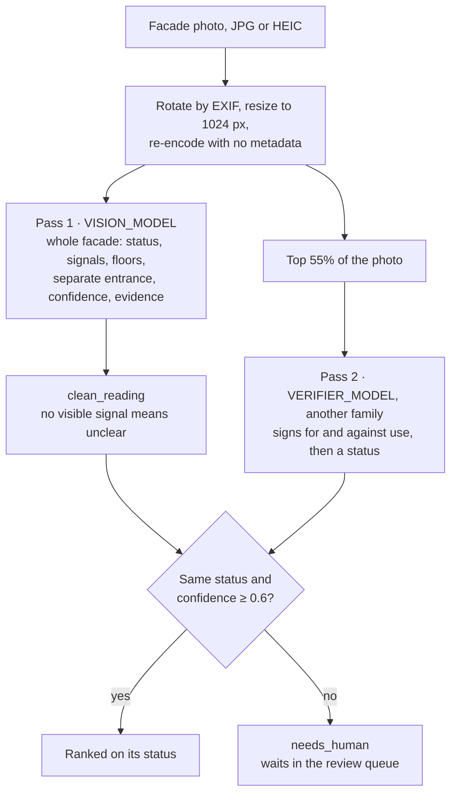

Both prompts are in [`pipeline/prompts/`](pipeline/prompts/). They ask for what is visible from the pavement and nothing else. The model ignores people and vehicles, judges only the building in the centre of the frame, and reads a ground floor behind closed shutters as "unclear", because many photos are taken on a Sunday morning.

### Display status

Every surface derives a building's status the same way, in Python ([`domain.py:12`](backend/app/domain.py#L12)) and in TypeScript ([`status.ts:26`](web/src/lib/status.ts#L26)). An officer's inspection outranks a human label, and a human label outranks the model.

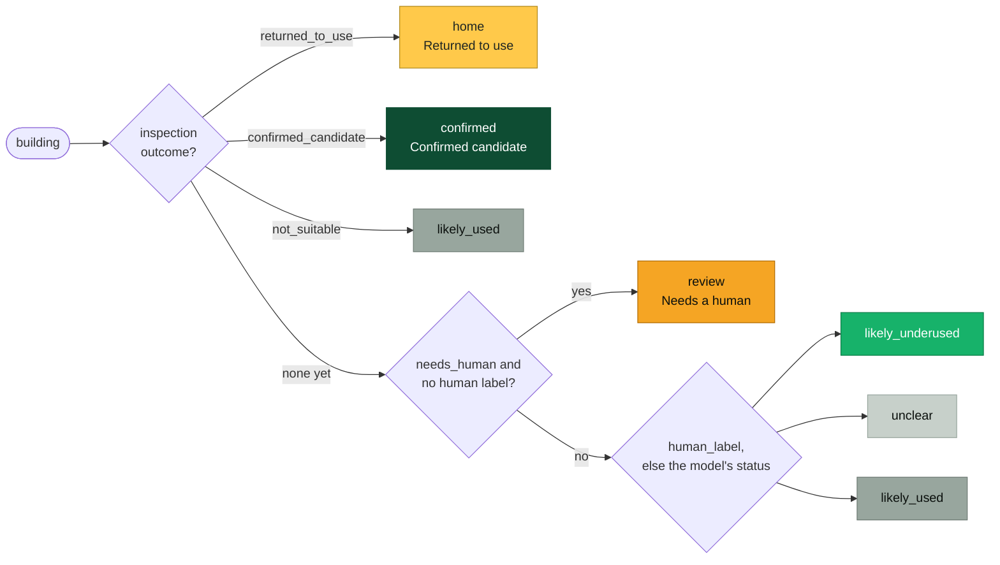

The colours are the UI's palette: green for likely underused, amber for review, grey for unclear and likely used, forest green for confirmed and gold for home. The contract (v1.1) still lists the original colours, which the 4 October redesign replaced.

### Ranking and services within walking distance

[`rank_key`](backend/app/domain.py#L81) orders the buildings on a street. Each line breaks the ties left by the line above.

| Order | Rule |
| ---: | --- |
| 1 | Likely underused, then unclear, then likely used. A confirmed candidate counts as likely underused; a not-suitable or returned building counts as likely used |
| 2 | A separate street door to the upper floors first |
| 3 | A higher services score first |
| 4 | Higher model confidence first |

For each building, [`services.py`](pipeline/services.py) finds the nearest service of each kind within 1 km with `$geoNear`, from one cached Overpass query. Each kind within its threshold scores one point ([`domain.py:63`](backend/app/domain.py#L63)).

| Service | OpenStreetMap tags | Scores within |
| --- | --- | ---: |
| Bus stop | `highway=bus_stop` | 400 m |
| Grocery | `shop=supermarket`, `shop=convenience` | 400 m |
| School | `amenity=school` | 800 m |
| GP or pharmacy | `amenity=doctors`, `amenity=clinic`, `amenity=pharmacy` | 800 m |
| Park | `leisure=park` | 800 m |

### The agent

The agent answers in at most eight lines, cites each building by id with its rank, evidence and services score, and says that every candidate needs human verification.

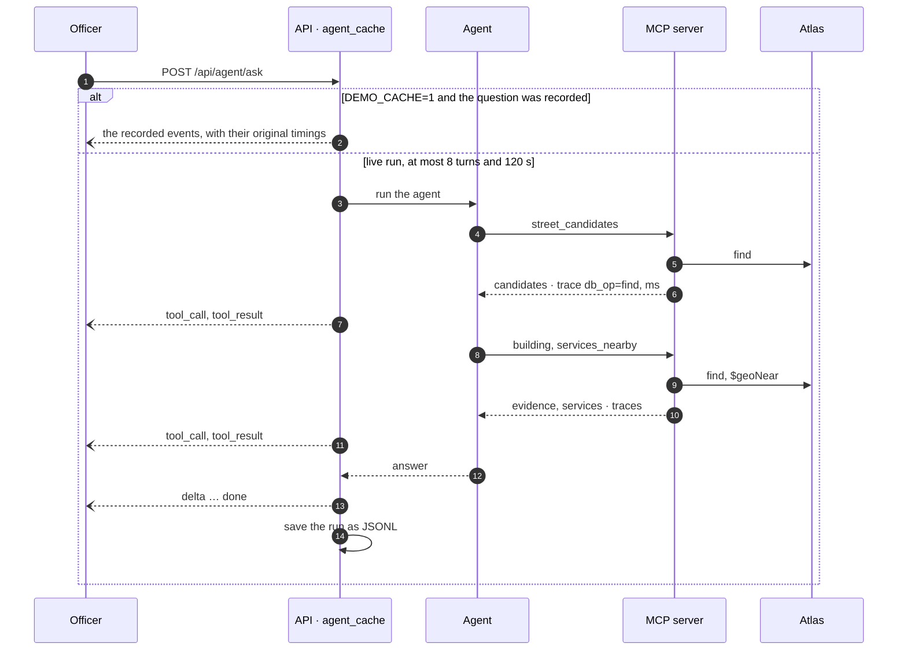

| Tool | Database operation | Returns |
| --- | --- | --- |
| `street_candidates(street, limit)` | `find` | ranked buildings on a street with status, evidence and services score |
| `building(id)` | `find` | one building: signals, evidence, confidence, the verifier's signs, inspection |
| `services_nearby(id)` | `$geoNear` | nearest bus stop, grocery, school, GP or pharmacy and park, with a score out of 5 |
| `review_queue()` | `find` | buildings waiting for a person |
| `street_summary(street)` | `find` | counts for a street: total, processed, underused, review, confirmed, home |
| `similar_facades(id, k)` | `$vectorSearch` or `cosine-fallback` | look-alike facades by embedding of their signals and evidence |
| `public_registers(id)` | `find` | DCC derelict-sites and protected-structures flags, or "not checked yet" |
| `grant_info()` | `static` | grant amounts and the official FAQ link, nothing about eligibility |

### Badges, and how the loop closes

Badges reward walking and coverage. The two civic badges arrive only after an officer records an inspection outcome on a facade the walker photographed.

| Badge | Earned when | Tier |
| --- | --- | --- |
| First Look | the first facade is captured | bronze |
| Street Scout | 10 facades are captured | silver |
| Main Street | 20 facades are captured on one street | gold |
| 5K for Homes | 5 km walked while capturing, in total | gold |
| Three-Day Streak | captures on 3 different days, by the Dublin calendar | silver |
| Local Knowledge | the walker logged an answer from shop staff | bronze |
| Second Look | the walker re-captured a facade another walker photographed first: perceptual hash within 8 bits, positions within 30 m | silver |
| Homes Above | a facade the walker captured was confirmed by a council inspection | civic |
| Lights On | a building the walker captured returned to use as homes | civic |

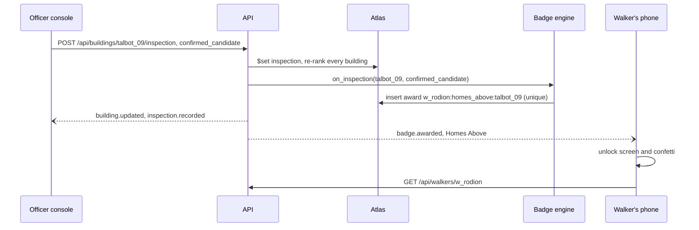

Every connected client receives every event, and the walker app shows only awards that name its walker. A failing badge engine never fails the officer's click: the inspection is already recorded ([`api.py:98`](backend/app/api.py#L98)).

<details>
<summary>REST endpoints and events</summary>

All routes sit under `/api` and return JSON. FastAPI serves interactive documentation at `http://localhost:8000/docs`.

| Method | Path | Returns |
| --- | --- | --- |
| `GET` | `/buildings?street=&status=` | GeoJSON FeatureCollection; properties are the building without its embedding, plus `display_status` |
| `GET` | `/buildings/{id}` | one building |
| `GET` | `/buildings/{id}/services` | `{services, pois: [{kind, name, lat, lon, dist_m}]}` |
| `GET` | `/buildings/{id}/similar?k=5` | `[{id, label, score, display_status, photo}]` |
| `GET` | `/review-queue` | buildings whose status is `review` |
| `POST` | `/buildings/{id}/human-label` | `{label}`, a person's screening of the photo; publishes `building.updated` |
| `POST` | `/buildings/{id}/inspection` | `{outcome, note}` → `{building, awards[]}`; publishes all three events |
| `GET` | `/streets/{street}/summary` | `{total, processed, likely_underused, review, confirmed, home}` |
| `GET` | `/context-buildings` | surrounding OSM buildings with `height_m` |
| `GET` | `/eval` | `{rows[], agreement: "X/N", escalated: Y, shop_confirmed: "Z/M"}` |
| `GET` | `/walkers/{id}` | `{walker, stats, awards[], progress[]}` |
| `GET` | `/walkers/{id}/walks` | walks with captures `[{building_id, lon, lat, t, thumb}]`, never AI fields |
| `POST` | `/walkers/{id}/evaluate` | runs the badge engine → `{awards[]}`; publishes `badge.awarded` for each |
| `GET` | `/badges` | the catalog |
| `GET` | `/events` | SSE: `building.updated {id}`, `inspection.recorded {id, outcome}`, `badge.awarded {walker_id, badge_id, building_id, title}` |
| `POST` | `/agent/ask` | `{question}` → SSE: `tool_call {id, name, args}`, `tool_result {id, name, ms, db_op, summary}`, `delta {text}`, `done {text}` |
| `GET` | `/health` | `{ok: true}` |

The route that creates awards publishes `badge.awarded`. Scripts call the API and never publish events themselves.

</details>

<details>
<summary>Data model</summary>

One Atlas database, `homesabove`. Writers never replace a document; each one `$set`s only the fields it owns.

| Collection | Holds | Written by |
| --- | --- | --- |
| `buildings` | one document per photo, `_id` = photo stem: label, street, location, footprint, both readings, verifier, `needs_human`, services, registers, rank, height, embedding, human label, shop-staff answer, inspection | the pipeline; `import_walk.py` sets `captured_by`, `captured_at`, `walk_id` and `phash`; the API sets `human_label`, `inspection` and `rank` |
| `pois` | bus stops, groceries, schools, GPs and pharmacies, parks | `services.py`, mirroring the Overpass cache |
| `walkers` | id, name, town | `import_walk.py` |
| `walks` | path, times, distance, building ids, photographer position per capture | `import_walk.py` |
| `awards` | walker, badge, building, time, reason; unique per (walker, badge, building) | the badge engine, through the API |

Indexes: `2dsphere` on `buildings.location` and `pois.location`, the unique awards index, and the Atlas vector index `facade_vec` on `buildings.embedding` (cosine, filters on `street` and `upper_status`). [`init_db.py`](backend/scripts/init_db.py) creates them all and carries on if the vector index cannot be made.

</details>

## Engineering decisions

Problems the one-day build had to solve, and where each decision lives.

| Problem | Decision | Code |
| --- | --- | --- |
| A model's reply can be malformed or out of range | Strict JSON schema, range checks in Pydantic validators, one retry with the validation error appended, then `unclear` and a person | [`llm.py:138`](backend/app/llm.py#L138), [`schemas.py:26`](backend/app/schemas.py#L26) |
| Not every model behind TensorX accepts strict structured output | Per model, fall back from `json_schema` to `json_object` to a schema in the prompt after a 400 that names the format, and remember it for the process | [`llm.py:105`](backend/app/llm.py#L105) |
| The provider reports `owned_by: "openai"` for every model, so it cannot tell families apart | Derive the family from the model id; the probe tests vision, strict JSON and tool calls for each model and picks the roles | [`probe_providers.py:114`](pipeline/probe_providers.py#L114) |
| A photo's GPS is the photographer, across the street | Project 18 m along `GPSImgDirection`, snap to the OSM footprint containing the point, else the nearest within 20 m. Over 800 m² means a merged terrace, so the map draws a prism instead | [`geo.py:57`](pipeline/geo.py#L57), [`geo.py:127`](pipeline/geo.py#L127), [`geo.py:219`](pipeline/geo.py#L219) |
| Re-running placement must not move buildings further each time | Always re-read the photographer's point from the photo or `labels.csv`, never from the stored location | [`geo.py:151`](pipeline/geo.py#L151) |
| Overpass is slow, rate-limited and unfit for a live demo | One query per area across three mirrors, cached on disk; a cache that does not cover every building is refused, never silently used | [`services.py:93`](pipeline/services.py#L93), [`services.py:128`](pipeline/services.py#L128) |
| The council's protected-structures GeoJSON puts its points in the Atlantic | Read the CSV instead and convert Irish Grid (EPSG:29902) to WGS84 with pyproj | [`registers.py:71`](pipeline/registers.py#L71) |
| Atlas M0 may have no vector index | Cosine in Python with the same `(1 + cos) / 2` score, reported as `cosine-fallback` | [`repo.py:157`](backend/app/repo.py#L157) |
| The demo cannot depend on model latency on the day | Save every completed agent run as JSONL with timings and replay it with `DEMO_CACHE=1`, gaps capped at 3 s; `record_demo.py` checks the replay equals the recording | [`agent_cache.py:69`](backend/app/agent_cache.py#L69), [`record_demo.py:68`](backend/scripts/record_demo.py#L68) |
| The front end must work with no backend at all | Every call goes through `either(remote, local)`; local writes emit the same three events as the server's SSE | [`api.ts:54`](web/src/lib/api.ts#L54), [`api.ts:215`](web/src/lib/api.ts#L215) |
| Events are published from worker threads, but SSE subscribers live on the event loop | `publish` hands each event over with `call_soon_threadsafe`; a slow subscriber drops its oldest event instead of blocking | [`events.py:49`](backend/app/events.py#L49), [`events.py:23`](backend/app/events.py#L23) |
| Spotting a re-photographed facade without asking a model | Perceptual hash within 8 bits and photographer positions within 30 m, the other capture earlier; tests sit on both edges, 9 bits and 31 m | [`engine.py:152`](backend/app/gamification/engine.py#L152), [`test_engine.py:164`](backend/app/gamification/tests/test_engine.py#L164) |
| A UTC date files a photo taken just after midnight in Dublin under the previous day | Streak days use the Europe/Dublin calendar, and EXIF times, which carry no zone, are read as Dublin wall time | [`engine.py:138`](backend/app/gamification/engine.py#L138), [`import_walk.py:82`](walker/import_walk.py#L82), [`test_engine.py:57`](backend/app/gamification/tests/test_engine.py#L57) |
| GPS jitter inflates walk distance | Drop a point within 4 m of the last kept one, or one that would need more than 3 m/s | [`import_walk.py:175`](walker/import_walk.py#L175) |

## Evaluation

[`pipeline/eval.py`](pipeline/eval.py) produces three numbers, served by `GET /api/eval` and shown in the officer console.

| Number | Measures | Does not measure |
| --- | --- | --- |
| `agreement` X/N | how often the AI status matches a person screening the same photo | accuracy: the person sees only the photo the model saw |
| `escalated` Y | buildings the pipeline sent to a person because the passes disagreed or confidence was below 0.6 | how many readings are wrong |
| `shop_confirmed` Z/M | of M shop-staff answers with a clear reading, how many support the AI status | much yet: shop staff are the only ground truth here, and there are few of them |

Shop-staff answers are free text, such as "Nobody's lived up there for years, it's only used for storage." `AGENT_MODEL` reads each one once as `lives_upstairs`, `empty_upstairs` or `unsure`, and the readings are cached in `data/cache/staff_readings.json` so the numbers do not move between runs.

This repository contains no evaluation run on real photos, so this README quotes no accuracy figure. [`data/labels.csv`](data/labels.csv) holds a person's screening of 14 phone photos taken on 4 October 2026 around Custom House Square, Store Street and City Quay: 11 likely used, 2 unclear and 1 likely underused, with no shop-staff answers yet. The photos themselves stay out of git. Once they are in `data/photos/`, `bash pipeline/real_photos.sh` turns them into the three numbers.

<details>
<summary>The evaluation view, showing demo numbers</summary>

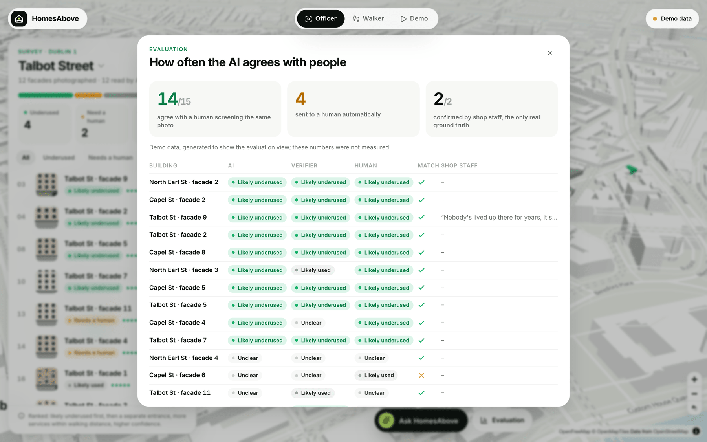

These numbers are invented, and the modal says so in the line under them. The view is real: the same component renders `GET /api/eval`.

</details>

## Run locally

### See it in a minute

You need Node.js 20.19+ or 22.12+ (Vite 7), and no keys.

```bash
git clone https://github.com/Adwerse/HouseAbove && cd HouseAbove/web
npm install
npm run dev        # http://localhost:5173
```

With nothing on port 8000, the first request fails over to the bundled demo dataset and the top bar says Demo data. Try `/`, `/walker/w_rodion` and `/demo`. The base maps load from OpenFreeMap and CARTO, so the browser needs an internet connection.

### The full stack

You need Python 3.11 or later (the team ran 3.13), a MongoDB Atlas cluster (the free M0 tier works, and vector search is optional), and a TensorX API key.

```bash
python -m venv .venv && source .venv/bin/activate
pip install -r backend/requirements.txt
cp .env.example .env                   # fill in MONGODB_URI, TENSORX_API_KEY, TENSORX_BASE_URL
python pipeline/probe_providers.py     # tests every TensorX model, prints the model lines for .env
python backend/scripts/init_db.py      # indexes; logs the cosine fallback if the vector index can't be made
```

Run each service in its own terminal:

```bash
cd backend && uvicorn app.main:app --port 8000   # REST, SSE and /photos; API docs at /docs
python backend/mcp_server.py                     # MCP on 127.0.0.1:8001/mcp, which the agent needs
cd web && npm run dev                            # http://localhost:5173
```

Survey your own street:

```bash
# copy the original JPG or HEIC files into data/photos/ (git-ignored), then:
python walker/import_walk.py --walker w_rodion --name "Rodion" --dry-run   # report only, nothing goes to Atlas
python walker/import_walk.py --walker w_rodion --name "Rodion"             # walks, captures, first badges
bash pipeline/real_photos.sh     # both readings, geo, services, eval, export, sync into web/public
python pipeline/registers.py     # optional: DCC derelict sites and protected structures
python pipeline/embed.py         # optional: facade embeddings for similar-facade search
```

`real_photos.sh` sets the model ids the team used (DeepSeek for pass 1, GLM for pass 2, Qwen for the agent and embeddings) for any that are not already exported in your shell. Export your own to override them. Both `import_walk.py` modes append rows for new photos to `data/labels.csv`, where you fill in the street, and coordinates for photos without GPS.

<details>
<summary>Static snapshot, demo cache and the terminal agent</summary>

A static snapshot lets the web app run with no backend and real data:

```bash
python pipeline/export.py && (cd web && npm run sync-data)
cd web && VITE_DATA_MODE=static npm run dev
```

The agent's demo cache and its terminal backup:

```bash
python backend/scripts/record_demo.py                         # records the five demo questions, checks each replay
cd backend && DEMO_CACHE=1 uvicorn app.main:app --port 8000   # recorded questions replay with their timings
python pipeline/agent_cli.py                                  # the agent in a terminal, over MCP stdio
```

`agent_cli.py` starts its own MCP server over stdio, so it needs only Atlas and TensorX, not the API. It also takes a single question with `--ask "…"`.

</details>

| Variable | Used by | Purpose |
| --- | --- | --- |
| `MONGODB_URI` | API, MCP server, pipeline, walker import | Atlas connection string; the database is `homesabove` |
| `TENSORX_API_KEY`, `TENSORX_BASE_URL` | every model call | the OpenAI-compatible, EU-hosted endpoint |
| `VISION_MODEL` | `survey_vision.py` | pass 1, the whole facade |
| `VERIFIER_MODEL` | `verify.py` | pass 2, the upper floors; must be another model family |
| `AGENT_MODEL` | `agent.py`, `eval.py` | the officer's agent, and reading shop-staff answers |
| `EMBED_MODEL`, `EMBED_DIM` | `embed.py`, `init_db.py` | facade embeddings; `fastembed:<name>` runs a local model instead |
| `DEMO_CACHE` | `agent_cache.py` | `1` replays recorded agent runs |
| `VITE_DATA_MODE` | web | `api` (default) or `static` |
| `VITE_DEMO_WALKER` | web | the walker shown at `/walker` and on the demo phone |

Vite reads `VITE_*` variables from the shell or from `web/.env`, not from the root `.env`.

| URL | What it is |
| --- | --- |
| http://localhost:5173 | the web app: `/` officer console, `/walker/:id` walker view, `/demo` guided demo |
| http://localhost:8000/api | the REST API and `GET /api/events`; interactive docs at `/docs` |
| http://127.0.0.1:8001/mcp | the MCP server, streamable HTTP |

## Tests

```bash
# Badge engine and walker routes: 27 tests against mongomock, no database needed
cd backend && pip install mongomock && python -m unittest discover -s app/gamification/tests -t . -v

# Every contract endpoint, the event stream, the agent stream and the MCP tool list, against a running stack
python backend/scripts/smoke.py                       # read-only
python backend/scripts/smoke.py --write               # also proves building.updated arrives on /api/events
python backend/scripts/smoke.py --inspect talbot_12   # records a real inspection and checks all three events

# Web app: type check and production build
cd web && npm run build
```

Each smoke check is tagged `[B]` or `[C]`, the contract owner of the code it exercises, so a failure points at the right person. `--inspect` writes a real inspection, so point it at a scratch building.

## Repository layout

```text
backend/
  app/
    main.py            FastAPI app: routers, /api/events, /photos
    api.py             REST routes and the agent stream
    repo.py            every Atlas read and write, for the API and MCP alike
    domain.py          pure rules: display status, ranking, services score, wording
    llm.py             TensorX adapter: strict JSON schema, fallbacks, validation
    agent.py           the officer's agent, OpenAI Agents SDK over MCP
    agent_cache.py     records and replays agent runs (DEMO_CACHE)
    events.py          in-process pub/sub behind the SSE stream
    imaging.py         EXIF, rotation, stripped copies, the upper-floor crop
    schemas.py         what each model pass must return
    gamification/      badge engine, walker routes and their tests
  mcp_server.py        eight read-only tools
  scripts/             init_db, smoke test, record_demo
pipeline/
  probe_providers.py   picks a model for each role from what TensorX serves
  survey_vision.py     pass 1, the whole facade
  verify.py            pass 2, the upper floors, another model family
  geo.py               OSM footprints and context buildings
  services.py          services within walking distance, then the ranking
  registers.py         DCC derelict sites and protected structures
  embed.py             facade embeddings and the vector index
  eval.py              agreement, escalations, shop-staff confirmation
  export.py            static snapshot for the web app
  demo_route.py        generates the bundled demo dataset
  agent_cli.py         the agent in a terminal, the demo backup
  real_photos.sh       one command from photos to a synced front end
  prompts/             survey.txt and verify.txt
walker/import_walk.py  photos into walkers, walks and captures (EXIF, pHash)
web/
  src/views/           officer console, walker view, guided demo
  src/walker/          the walker's phone app
  src/map/             one shared 3D map for every view
  src/lib/             API client with static and demo fallback, SSE, types
  src/mocks/           demo-data.json, generated by demo_route.py
contracts/CONTRACT.md  the team contract: schema, ownership, REST, events, badges, product rules
data/labels.csv        a person's screening of the real photos, and shop-staff answers
docs/screenshots/      the images on this page
```

## Limitations

- **A photo shows signals, not occupancy.** A status describes what is visible from the pavement, so "likely underused" is a reason to look, not a finding. Doors to upper floors are often at the back, which is why the separate-entrance field is usually "unclear".
- **No accuracy figure yet.** Agreement with a person screening the same photo is not accuracy, and shop-staff answers, the only ground truth, are few. See [Evaluation](#evaluation).
- **The demo dataset is invented.** Real OpenStreetMap geometry, invented readings. Its OSM inputs in `data/cache/demo/` are git-ignored, so `pipeline/demo_route.py` only runs where those caches exist.
- **Register flags are proximity checks.** A building is flagged when a register point lies within 20 m, and in a terrace that point can belong to the neighbour. The council's own register is the authority, and only Dublin City Council's registers are wired in.
- **There is no authentication.** Anyone who can reach port 8000 can record labels and inspections. CORS admits only `http://localhost:5173`, but that is not access control.
- **Live events assume one API process.** The pub/sub is in memory, so with several workers an event reaches only the clients connected to the worker that published it. A client that falls 1,000 events behind loses the oldest.
- **Reads scan the whole collection.** Street filters and summaries run in Python over every building, and each label or inspection re-ranks them all. That suits a few streets, not a city.
- **"Returned to use" is simulated in the demo.** Real conversions take months.
- **Walkers have no accounts.** The walker id comes from the URL or `VITE_DEMO_WALKER`.
- **The web app has no automated tests.** `npm run build` type-checks it; the smoke test covers the API it talks to.

## Credits

- Map data © [OpenStreetMap](https://www.openstreetmap.org/copyright) contributors, under the ODbL: footprints, streets and services in the pipeline caches and the demo dataset.
- Base maps: [OpenFreeMap](https://openfreemap.org) Positron with OpenMapTiles for the main map, and CARTO Dark Matter for the walk replay.
- Dublin City Council's Derelict Sites Register and Record of Protected Structures, from [data.smartdublin.ie](https://data.smartdublin.ie), under CC BY.
- Model inference by TensorX, EU-hosted, through its OpenAI-compatible API.
- Built at Build for Ireland 2026 by Adam Vakar and Rodion Omelich.
- AI assistance: Codex was used to scaffold, integrate, test and polish the frontend.

## Further reading

- [`contracts/CONTRACT.md`](contracts/CONTRACT.md): the frozen team contract, with the schema, field ownership, REST shapes, events, badge catalog and product rules.
- [`AGENTS.md`](AGENTS.md): the rules for coding agents working in this repository ([`CLAUDE.md`](CLAUDE.md) is the same file).
- [`pipeline/prompts/`](pipeline/prompts/): the two vision prompts.
- [`backend/scripts/smoke.py`](backend/scripts/smoke.py): the contract as executable checks.
- [`docs/BRIEF.md`](docs/BRIEF.md) is still a placeholder. The rules it was meant to hold live in the contract, the prompts and [`domain.py`](backend/app/domain.py).

There is no licence file yet.
